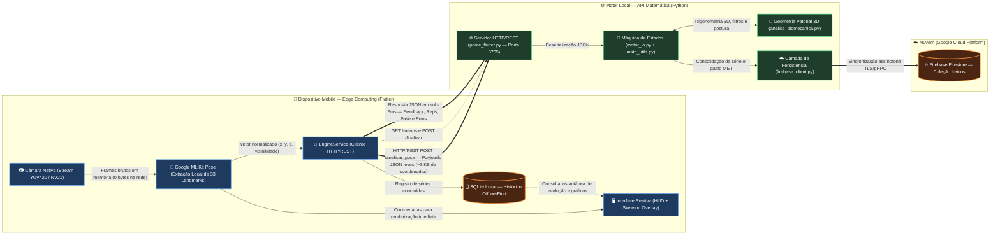
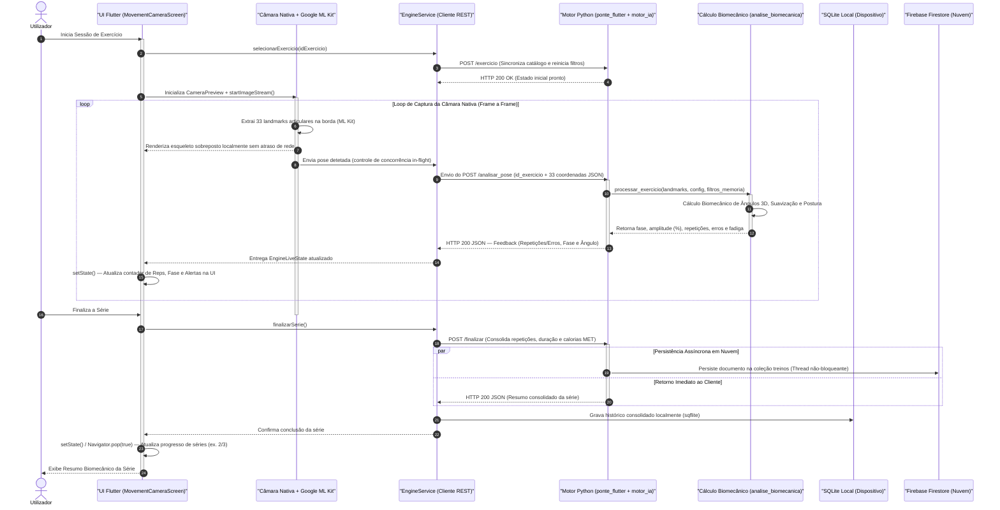

# 🏛️ Arquitetura de Software do IAFit — Edge Computing & API Matemática

Este documento apresenta a modelagem arquitetural e comportamental do **IAFit**, concebida sob o paradigma de **Computação de Borda (*Edge Computing*)** aliada a um **Motor Matemático desacoplado** e **Persistência Híbrida (*Offline-First* + *Cloud*)**. Os diagramas abaixo detalham a distribuição de responsabilidades e o ciclo de vida em tempo real de uma sessão de análise biomecânica.

---

## 1. Diagrama de Arquitetura (Edge Computing + Persistência Híbrida)

### Justificativa Arquitetural e Redução de Latência na Rede

Em arquiteturas tradicionais e monolíticas de visão computacional, o cliente atua apenas como um coletor de imagem que codifica e transmite continuamente quadros de vídeo (via MJPEG, WebRTC ou *frames* Base64) para um servidor processar a rede neural. Mesmo em resolução moderada (720p), cada quadro comprimido consome entre **80 KB e 300 KB**, gerando tráfego superior a **3 MB/s a 8 MB/s** a 30 FPS, além de acumular atrasos de compressão JPEG, contenção em redes Wi-Fi congestionadas e decodificação de matrizes de pixels no servidor.

Ao migrar a inferência de pose para a borda (**Flutter + Google ML Kit Pose Detection** acelerado pela NPU/GPU do próprio *smartphone*), o IAFit elimina integralmente o tráfego de vídeo na rede:

| Critério Técnico | Streaming Monolítico de Vídeo | Edge Computing + API Matemática (IAFit) |
| :--- | :--- | :--- |
| **Carga útil por frame na rede** | ~100 KB a 300 KB (imagem comprimida) | **~2 KB** (JSON com 33 pontos `x, y, z, vis`) |
| **Redução de largura de banda** | Referência base (100%) | **Superior a 98% de redução** |
| **Custo de CPU/GPU no servidor** | Alto (decodificação de vídeo + inferência CNN) | **Mínimo** (apenas álgebra vetorial e trigonometria `O(1)`) |
| **Privacidade (*Privacy by Design*)** | Imagens do utilizador trafegam pela rede | **Total** (nenhum pixel abandona o telemóvel) |
| **Resiliência de armazenamento** | Dependente de conectividade contínua | **Híbrida** (`SQLite` local instantâneo + `Firestore` assíncrono) |

Essa decisão arquitetural reduz o tempo de ida e volta (*Round-Trip Time*) de centenas de milissegundos para poucos milissegundos (especialmente via rede local ou túnel físico `adb reverse`), permitindo evolução independente das regras biomecânicas em Python sem necessidade de recompilar ou redistribuir o aplicativo móvel.

---

## 2. Diagrama de Sequência (Fluxo de Execução em Tempo Real)

### Análise do Fluxo de Execução e Controle de Latência

O fluxo temporal acima foi projetado para desacoplar a **taxa de quadros visual (UI a 60 FPS)** da **taxa de amostragem cinemática da rede**, evitando travamentos (*jank*) ou filas de pacotes atrasados (*bufferbloat*):

1. **Renderização Local Imediata:** Assim que o `CameraController` entrega um frame em memória ao **Google ML Kit**, o esqueleto anatômico é desenhado imediatamente sobre o `CameraPreview` no próprio dispositivo, garantindo percepção visual de latência zero para o utilizador.
2. **Controle de Concorrência (*Backpressure*):** O `EngineService` envia o `POST /analisar_pose` com um único objeto JSON compacto contendo o `id_exercicio` e as 33 coordenadas tridimensionais normalizadas, descartando quadros excedentes caso uma requisição ainda esteja em trânsito — o que elimina atrasos cumulativos em redes Wi-Fi instáveis.
3. **Processamento Determinístico em Memória:** No Back-end Python, o servidor ignora qualquer etapa pesada de visão computacional e executa apenas operações algébricas de produto escalar vetorial, filtragem de média móvel (`FiltroSuavizacao`) e transições da máquina de estados (`base` → `subida` → `topo` → `descida`), respondendo em frações de milissegundo para acionar o `setState()` no Flutter.
4. **Persistência Não-Bloqueante no Encerramento:** Ao concluir a série (`POST /finalizar`), o envio para o **Firebase Firestore** ocorre em *thread* secundária assíncrona enquanto o **SQLite** local é atualizado de imediato no telemóvel, assegurando que a transição de ecrã e o avanço do contador de séries ocorram instantaneamente mesmo sem acesso à internet.
