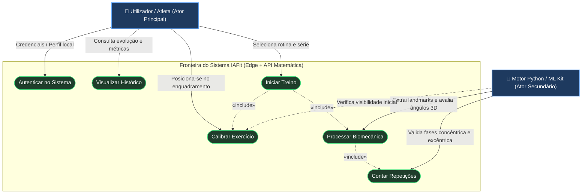
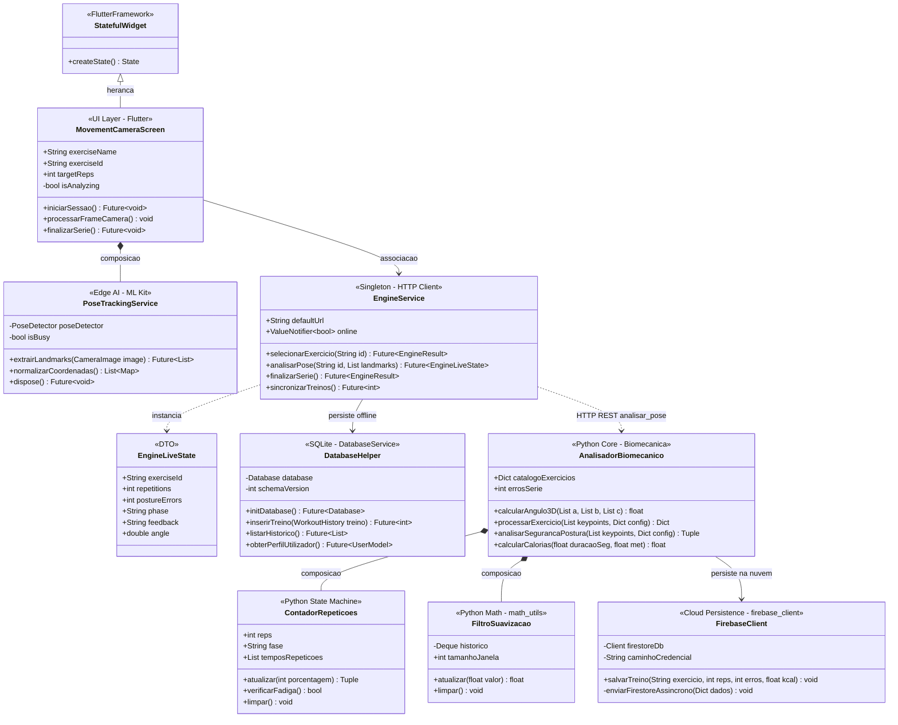
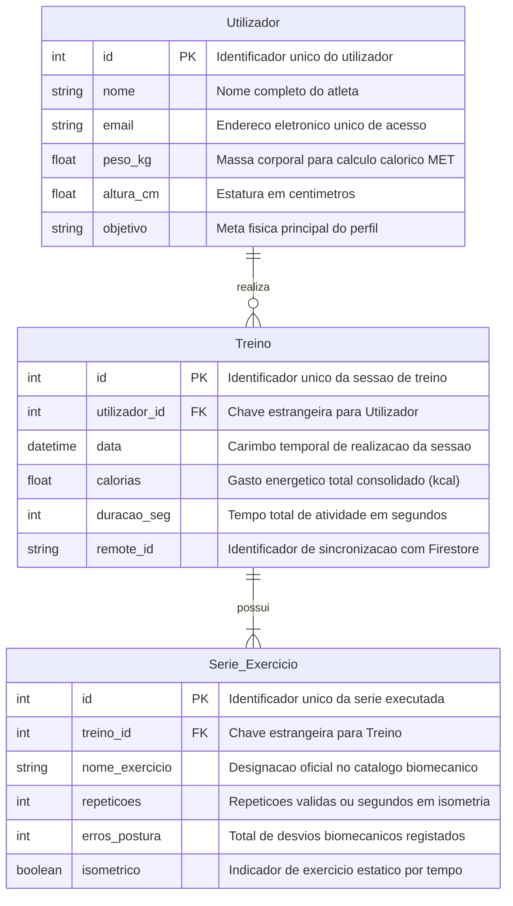

# 📐 Modelagem UML e Entidade-Relacionamento — Projeto IAFit

Este documento compõe o caderno de engenharia de software do Trabalho de Conclusão de Curso (TCC) do sistema **IAFit**, reunindo as visões funcional (**Casos de Uso**), estrutural orientada a objetos (**Diagrama de Classes**) e de persistência relacional/documental (**Diagrama Entidade-Relacionamento — DER**).

---

## 1. Diagrama de Casos de Uso

### Descrição Académica — Visão Funcional

O **Diagrama de Casos de Uso** delimita as fronteiras funcionais do ecossistema **IAFit** e explicita a cooperação entre o agente humano e o subsistema inteligente de visão computacional:

* **Ator Principal (*Utilizador / Atleta*):** Interage diretamente com a camada de apresentação em Flutter para gerir o seu acesso e perfil antropométrico (**Autenticar no Sistema**), acompanhar gráficos de desempenho calórico e postural (**Visualizar Histórico**), posicionar-se perante a câmara (**Calibrar Exercício**) e conduzir as séries prescritas (**Iniciar Treino**).
* **Ator Secundário (*Motor Python / ML Kit*):** Representa o par cooperativo formado pelo extrator de pose na borda (*Google ML Kit*) e pela API matemática em Python, atuando autonomamente nos casos de uso internos incluídos (`«include»`) durante o treino: **Processar Biomecânica** (cálculo vetorial tridimensional e deteção de desvios posturais) e **Contar Repetições** (máquina de estados finitos das fases do movimento).

---

## 2. Diagrama de Classes (Núcleo do Sistema)

### Descrição Académica — Arquitetura Orientada a Objetos e Modularidade

O **Diagrama de Classes** evidencia a aplicação dos princípios **SOLID** e de **Separação de Preocupações (*Separation of Concerns*)** entre o cliente móvel (Dart/Flutter) e o servidor matemático (Python):

* **Camada Front-end (Flutter):** A classe `MovementCameraScreen` especializa `StatefulWidget` (**herança**) para gerir o ciclo de vida reativo da interface durante a execução da série, compondo uma instância dedicada de `PoseTrackingService` (**composição**) encarregada de extrair localmente os 33 marcos anatômicos via Google ML Kit. A comunicação externa e a orquestração local são abstraídas pelo *Singleton* `EngineService`, que converte respostas HTTP em objetos imutáveis `EngineLiveState` e delega a gravação relacional ao `DatabaseHelper` (`DatabaseService` / `sqflite`).
* **Camada Back-end (Python):** O módulo central representado por `AnalisadorBiomecanico` agrega por **composição** os objetos de estado `ContadorRepeticoes` (responsável pela máquina de estados `base → subida → topo → descida` e deteção algorítmica de fadiga concêntrica) e `FiltroSuavizacao` (janela deslizante de média móvel para supressão de ruído de captura). Ao término da série, associa-se ao `FirebaseClient` para persistência não-bloqueante na nuvem.

---

## 3. Diagrama Entidade-Relacionamento (DER)

### Descrição Académica — Modelo de Dados e Persistência

O **Diagrama Entidade-Relacionamento (DER)** formaliza o modelo conceitual e lógico dos dados biométricos e cinemáticos recolhidos pelo **IAFit**, estruturado na Terceira Forma Normal (3FN) com cardinalidades **1 para N (`1:N`)**:

* **`Utilizador` → `Treino` (`1:N`):** Um utilizador registado pode realizar zero ou várias sessões de treino ao longo do tempo, enquanto cada registo em `Treino` pertence exclusivamente a um único atleta (`utilizador_id`), preservando parâmetros antropométricos essenciais para a estimativa individualizada de quilocalorias via índice **MET (*Metabolic Equivalent of Task*)**.
* **`Treino` → `Serie_Exercicio` (`1:N`):** Cada sessão de treino agrega uma ou múltiplas séries granulares em `Serie_Exercicio` (`treino_id`), permitindo rastreabilidade analítica por movimento (`nome_exercicio`), volume efetivo (`repeticoes`) e qualidade técnica de execução (`erros_postura`). No dispositivo móvel, esta estrutura sustenta as consultas SQL em **SQLite** para exibição imediata offline, ao passo que os resumos consolidados e o identificador `remote_id` asseguram idempotência e consistência eventual com a coleção `treinos` no **Firebase Firestore**.
