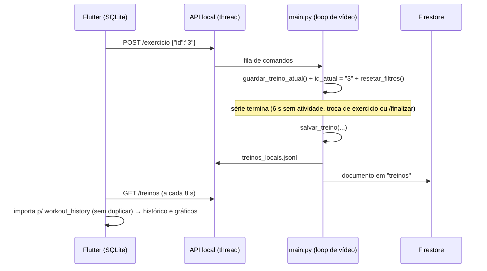

# 🔌 Integração Flutter ⇄ Motor Python (IAFit)

O app `fitness-app` (Flutter, SQLite local) conversa com o `main.py` por uma **API HTTP local** (`core/ponte_flutter.py`, só biblioteca padrão).
O Firestore continua a ser alimentado como antes (contrato em [`ESTRUTURA_FIREBASE.md`](ESTRUTURA_FIREBASE.md)).



## ▶️ Como usar (Zero-Config no Desktop)

1. **No Desktop (Linux / Windows / macOS)**:
   - Basta abrir o app Flutter (`flutter run -d linux`).
   - O endereço `http://127.0.0.1:8765` já vem **ativo por padrão**.
   - O app verifica `GET /saude` ao iniciar (e ao abrir um treino/exercício) e, caso o motor não esteja ativo, **inicia automaticamente** `../venv/bin/python ../main.py` em segundo plano (`Process.start`), sem abrir janela avulsa do OpenCV.
   - Os frames da webcam (`FONTE_DE_VIDEO = 0`) processados pelo MediaPipe/OpenCV são transmitidos via MJPEG (`GET /video_feed`) e exibidos diretamente dentro das telas de treino e exercício do Flutter.
2. **Em dispositivos móveis (Android / iOS)** — *Configurações → Motor IAFit → Conexão com o motor*:
   | Onde o app corre | Endereço |
   | :--- | :--- |
   | Desktop / Web / simulador iOS | `http://127.0.0.1:8765` *(padrão ativo)* |
   | Emulador Android | `http://10.0.2.2:8765` |
   | Telemóvel físico | `http://IP-DO-PC:8765` *(inicie o motor com `IAFIT_API_HOST=0.0.0.0`)* |

3. **Escolher o exercício**: em *Exercícios → (exercício) → ANALISAR NO MOTOR IAFIT*, ou ao iniciar um treino (*COMEÇAR TREINO*), onde o vídeo ao vivo e a contagem da IA aparecem integrados na própria tela.
4. **Ver os resultados**: ao fechar a série, o treino aparece automaticamente em *Progresso* (histórico, totais, repetições, erros de postura e gráfico semanal).

## 🌐 Endpoints

| Método | Rota | Descrição |
| :--- | :--- | :--- |
| `GET` | `/saude` | Verificação de disponibilidade |
| `GET` | `/exercicios` | Catálogo: `id`, `nome`, `tipo` (`reps`/`tempo`), `met` |
| `GET` | `/estado` | Série em curso: exercício, repetições, segundos, erros de postura, estado, fase e feedback |
| `GET` | `/video_feed` | Stream MJPEG (`multipart/x-mixed-replace`) em tempo real dos frames processados |
| `GET` | `/treinos?limite=N` | Últimos *N* treinos (padrão 200, máx. 1000), ordem cronológica |
| `POST` | `/exercicio` | `{"id": "3"}` → troca `id_atual` (guarda antes a série em curso) |
| `POST` | `/finalizar` | Guarda e reinicia a série em curso |

Treino devolvido por `/treinos` (e gravado em `treinos_locais.jsonl`):

```json
{
  "id": "b8451a1e01384979b1fb5eba8db121a2",
  "exercicio": "Flexao de Braco",
  "exercicio_id": "3",
  "repeticoes": 12,
  "erros_postura": 2,
  "calorias": 1.26,
  "duracao_seg": 40,
  "isometrico": false,
  "data": "2026-10-25T05:44:52.948121+00:00"
}
```

## 🗄️ Mapeamento no Flutter

| Origem (JSON) | `workout_history` (SQLite v3) | Observação |
| :--- | :--- | :--- |
| `id` | `remoteId` (índice único) | Evita duplicados em cada sincronização |
| `exercicio` | `workoutName` | |
| `repeticoes` | `repetitions` | Em isométricos são segundos (`isometric = 1`) |
| `erros_postura` | `postureErrors` | |
| `calorias` | `caloriesExact` / `calories` | `calories` = arredondado (compatível com telas antigas) |
| `duracao_seg` | `durationSeconds` / `duration` | `duration` = minutos (arredondado para cima) |
| `data` | `date` | Convertida para hora local |

A migração v2 → v3 só **adiciona colunas opcionais**; treinos antigos permanecem intactos.

## ⚠️ Segurança e limitações

- A API escuta em `127.0.0.1` por padrão. Ao usar `0.0.0.0`, defina `IAFIT_API_TOKEN` e use apenas redes confiáveis (HTTP sem TLS).
- O CORS é `*` por padrão (necessário para Flutter Web); restrinja com `IAFIT_API_CORS_ORIGIN`.
- Android: `usesCleartextTraffic="true"` foi ativado no manifesto para permitir HTTP local; iOS: `NSAllowsLocalNetworking`.
- No Desktop, o app inicia e encerra automaticamente o processo `main.py` em segundo plano; em dispositivos móveis, inicie `IAFIT_API_HOST=0.0.0.0 python main.py` no PC.
- Exercícios do app sem equivalente no motor (ex.: leg press) não acionam a análise (`lib/models/engine_exercise_map.dart`).
- Ao concluir um treino no app, o registo do plano (calorias/duração previstas) continua a ser gravado **além** das séries reais importadas do motor.

